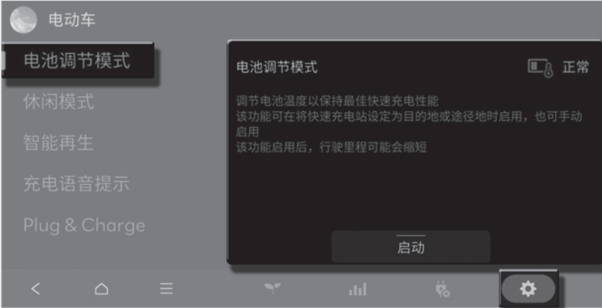
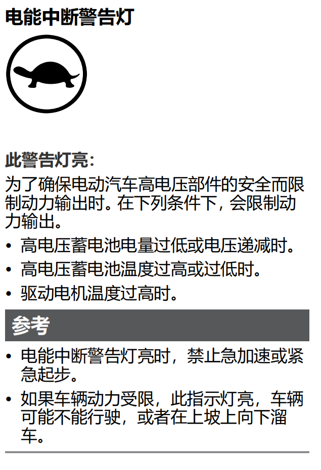

# 充电

- 如果要坐车里等，插枪前可以不熄火
- 如果等待时要离开，按一下点火按钮熄火出去锁车就行
- 如果充电中回到车上要吹空调，踩刹车按一下点火按钮，高压电会接通开始用压缩机
- 充电完毕后会跳到“待机”状态，此时拔掉枪踩刹车再启动一次就可以走了

## 交流家充

- 最大支持11KW
- 车机和家桩上的预约充电设置一个就行，都设置容易有bug

## 直流快充

- 车辆适配性较差，优先选择支持800V快充的站，谨慎充400V和60KW的桩，有概率损坏逆变器

  推荐站点：

  - 理想

  - 小鹏

  - 极氪

  - 等新能源车企充电站

- 冬季去快充充电前，先在车机首页EV菜单内打开电池加热，可以有效减少充电时间

  

**常见问题：**

- 如果充电时间较长，温度较高，充完启动后仪表可能会亮几秒钟黄色小乌龟，属于正常现象

  

- 遇到不适配的枪，会发生：

  1. 充电几秒/几分钟就跳枪。直接换枪/站，不用挣扎。重试多了可能发生第二种情况

  2. 跳枪，并提示红色警告“请检查电动系统”。熄火下车锁门，等5-10分钟，没意外的话警告会消失

  3. 警告还在，逆变器或ICCU可能损坏，参见[常见问题](../faq/)处理

     

## 其他注意事项

- 快充头插枪前检查是否有异物，枪内接触片是否异位，垂直缓慢插入，否则可能损坏充电口内接触簧片，维修价1w左右