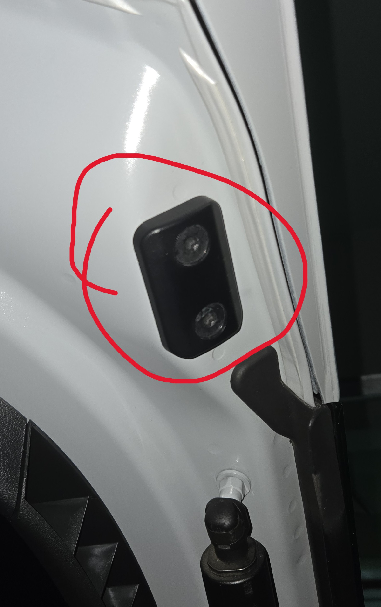
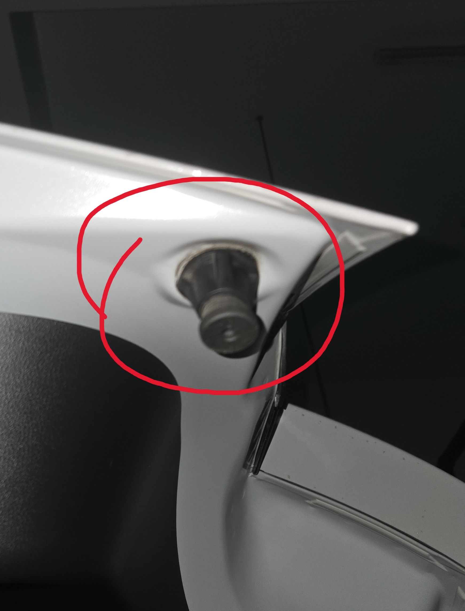
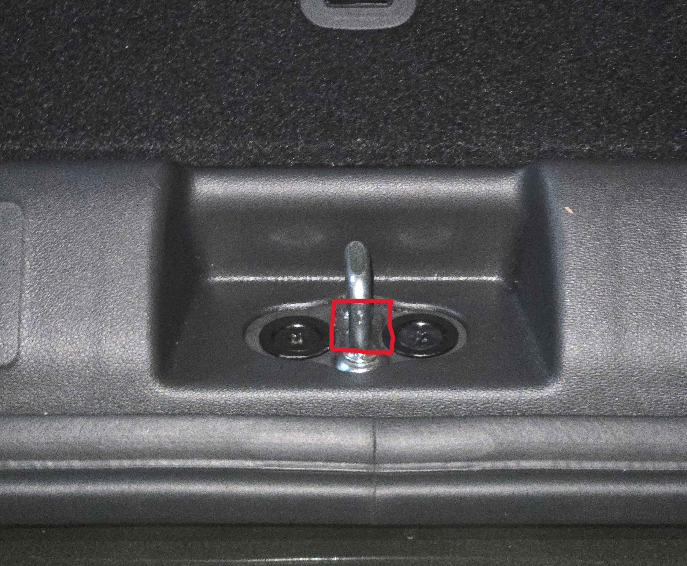
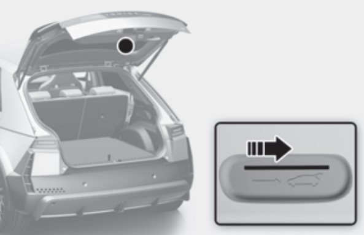
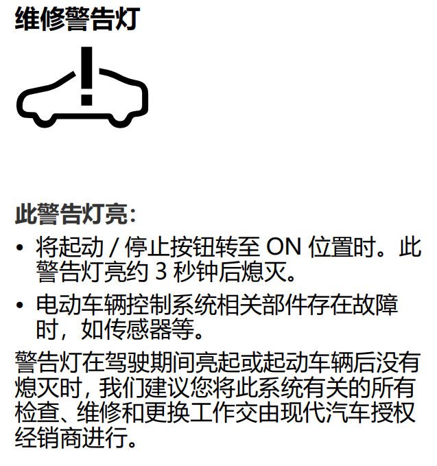
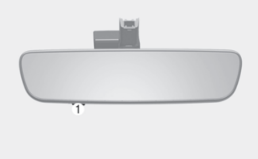
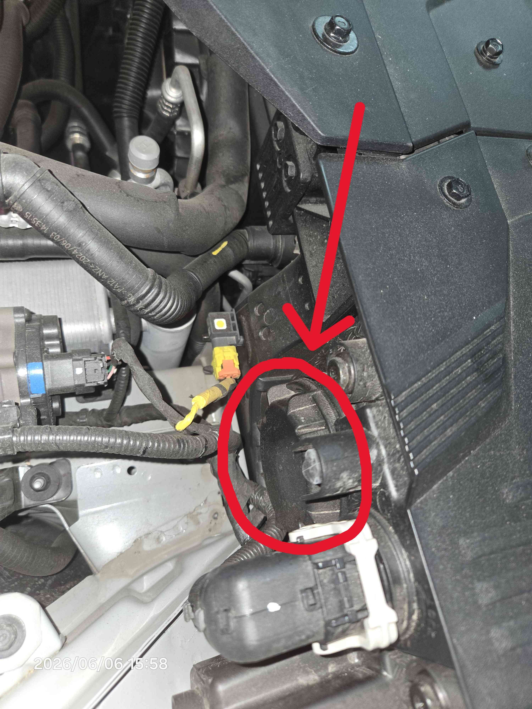

# 常见问题

**客服/救援电话：400-885-3388**

## 后备箱异响

如果行车中过颠簸发现后侧有异响，可以检查后备箱几个地方：

1. **后备箱盖板下**

   把盖板完全拿出来，下面比较深，检查有没有东西留在深处，提车时会给：放电枪、220v充电枪、网兜、拖车钩。一般都是拖车钩的声音，可以放到应急补胎包里，斜着正好能塞进去

2. **尾门垫块A**

   可尝试贴一层1-2mm的厚胶上去

   

3. **尾门垫块B**

   检查根部圆圈缓冲垫有没有脱出，也可旋转让它伸缩来调整空隙

   

4. **锁扣**

   可在靠近车外的垂直处按图片所示的宽度缠2-4圈布基胶带上去，不要多了要不然锁不上了

   

## 电瓶亏电

一般会出现两种亏电情况：

1. 未接通高压电并持续用电，比如贴膜的时候，这类情况建议完全启动车辆，或者进入露营模式（**主菜单 > EV > 齿轮图标 > 休闲模式**）

   注册bluelink后，挂在P挡有开关门动作后一段时间不动会开始给你发多条短信，不想收的话也可以进入露营模式

2. 系统出现bug，会导致车辆熄火后持续用电，具体触发条件未知，目前只知道有一个场景可能复现：在打开后备箱的时候熄火，再关闭后备箱锁车，这时候可能大灯不会熄火。建议是把大灯改成熄火即熄灭（**设置 > 车辆 > 灯**）

**亏电后怎么办：**

- 机械钥匙开门：没啥说的，出远门建议带上机械钥匙

- 开后备箱：在后备箱门底部的开槽内插入一字型螺丝刀等细长而扁平的工具，往右推

  

- 搭电：优先尝试负极搭铁的方式来充电，直接充电瓶可能会亮故障灯，就要去4s复位了

  另外建议备一个搭电宝，以防万一，毕竟bug出现过于随机

## ICCU

是什么：Integrated Charging Control Unit，负责给小电瓶充电的零件

表现：

- 后座方向听到像塑料袋充气后爆掉“啵”的一声

- 仪表上方出现红色小电瓶标志（充电结束后也会有，这个场景不用慌，只是说明车没有启动）

  

- 仪表弹红色警告“请安全停车后检查供电系统”，中控自检页面显示**OBC故障**

应对：

1. 马上把车靠边，在地库的开到地面上，这个情况电瓶电用完后就不能动了，速度很快
2. 叫救援

没电了上不去拖车怎么办：

1. 用搭电宝给小电瓶充电，启动后松开电子手刹拖上去或者自己开上去
2. 充不上电就把后轮抬起来，也能拖上去

## 逆变器

用了垃圾桩充电后可能会出问题，表现是快充/慢充无法使用，并弹红色警告（见下），暂时不影响其他功能，可以开去4s修

## 高压电池模组

表现：

- 续航大幅度下降，充电到百分之七八十直接跳到满
- 一段时间后仪表弹红色警告“请检查电动系统”，并无法进行充电，中控自检页面显示**BMS故障**

   

原因：电池内有模组出现故障，导致电压差过大

处理：去4s上报和订配件，等到货后更换，可以先把故障码消了正常开

预防：购买[维保篇](../maintenance/)中的OBD自己检查，如果`Cell Diff`这个项目持续大于了0.04V，就是有模组挂了。也不用太担心这事，电池的可维护性很好，哪坏换哪，和其他车CTB车身+一次性电池不一样

## ETC

开通：**中国ETC服务** 小程序。通过小程序去连接，不要自己用蓝牙连，搜不到的话熄火再启动再搜，可参考[文件合集](../manual/)中的说明

操作：

- 短按：调音量
- 长按：静音
- 长按10秒：初始化

## 大灯起雾

可以更换干燥剂，打开车头盖，大灯后面圆形处就是存放的地方，逆时针旋转后抽出即可，里面有两颗十字螺丝固定

原厂规格35g，40g也能塞下，尽量买没背胶、双面都能吸水的

## RaceChrono读取不到OBD数据流

需要导入一份配置文件：[文件合集](../manual/)

**注意：** 监控的整体刷新率有限，根据下面的表格，按需添加不同的关键数据源。同一PID的数据源添加再多也不会慢，反之，PID越多则刷新率越低

### 推荐使用的通道

当仅使用这个 `0x220101` PID 时，可获得每秒5到6次的刷新率

| Channel               | PID      |
| --------------------- | -------- |
| Battery level         | 0x220101 |
| Power (kW)            | 0x220101 |
| Speed                 | 0x220101 |
| Battery current (A)   | 0x220101 |
| Battery temperature 1 | 0x220101 |
| Battery temperature 2 | 0x220101 |
| Battery voltage (V)   | 0x220101 |
| Engine RPM (Front)    | 0x220101 |
| Engine RPM (Rear)     | 0x220101 |

### 慎重选择的通道

下列通道使用不同的Header/PID，组合到一起会降低整体刷新率，可能会降低50%的速率

| Channel                  | OBD-II header | PID      |
| ------------------------ | ------------- | -------- |
| Accelerator position (%) | 0x7E2         | 0x22E004 |
| Air temperature          | 0x7B3         | 0x220100 |
| Speed                    | 0x7B3         | 0x220100 |
| Battery level            | N/A           | 0x220105 |
| Brake position (%)       | 0x7D1         | 0x220104 |
| Steering angle           | 0x730         | 0x22F010 |
| Tire pressure (FL)       | 0x7A0         | 0x22C00B |
| Tire pressure (FR)       | 0x7A0         | 0x22C00B |
| Tire pressure (RL)       | 0x7A0         | 0x22C00B |
| Tire pressure (RR)       | 0x7A0         | 0x22C00B |
