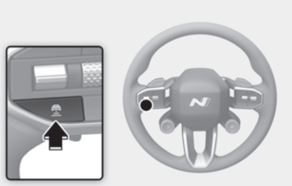
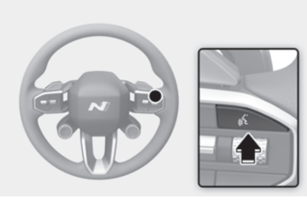
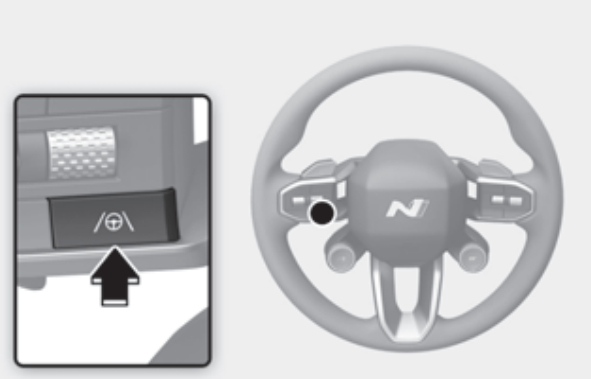
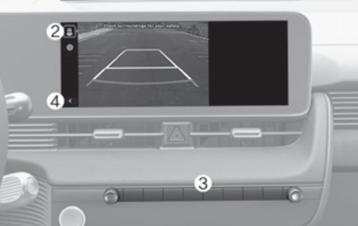
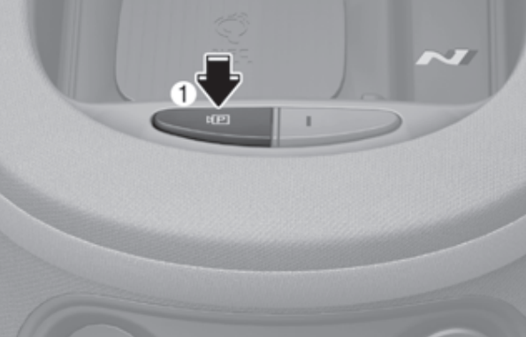
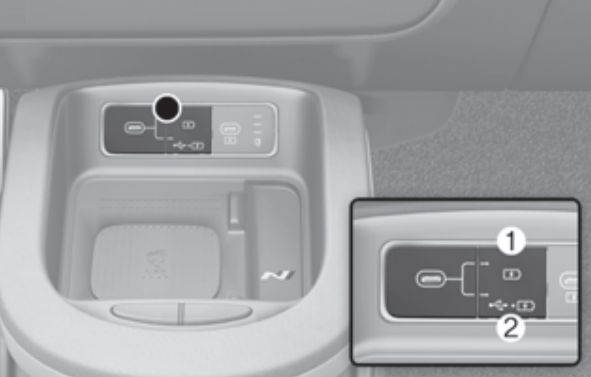

# 方向盘、仪表、车机、中控

- 方向盘上大部分按键都可以长按，有些是快速跳转车机设置，有些是特殊功能

  - 长按车距调整按钮可以切换“固定车距”和“智能车距”，仪表上图标变成蓝色就是智能的，对应车机里“**设置 > 车辆 > 驾驶员辅助 > 驾驶便利 > 智能巡航控制 > 驾驶风格联动**”

    区别：

    - 固定模式有车插队就马上刹车，慢速跟车时会保持固定车距
    - 智能模式有车插队会算相对速度，速度差不多就不刹车，慢慢拉开距离，慢速跟车会自己调整距离

      

  - Drive Mode长按可以切换到N模式，所以两个卫星按键可以拿来绑定N Custom两个模式和E-Shift

  - 有时候误触发语音助手，长按语音按钮可以终止，直接说“退出”也行

    

  - 车道保持按钮长按可以关闭车道偏移辅助，仪表上会多一个黄色的图标，不关的话不打灯变道会给你拉回来，这个开关是可以记忆的，其他的辅助功能需要每次启动后在P挡状态去“驾驶员辅助”里关

    

- 拨片的用法和说明
  - 电车模式
    - 拉左拨片到max后再拉一次可以到i-Pedal模式，也就是常说的单踏板模式，可以完全停下车，其他则会蠕行
    - 一直拉着右拨片可以到AUTO回收模式，这个模式会根据车距和相对速度自动调回收力度，在这个模式下拉左右拨片可以调最小回收力度
    - 在0-3挡力度下，一直拉左拨片可以直接触发最大回收力度并且能完全停下，可以说是手动控制的单踏板模式
  - 换挡模式（E-Shift）
    - 拉一下任意拨片可以进入手动模式，一直拉右拨片可以回到自动挡模式
    - 一直拉左拨片可以快速降到最低挡位

- 倒车影像可以切换摄像头并记忆，按2号图标以及它下面的图标可以切换不同位置的摄像头，比如轮边摄像头，可以弥补没有后视镜下翻的功能。同样挂D挡时也可以打开摄像头，见下

  

- 无线充电板后面的两个按钮，左边短按可以随时打开摄像头，长按可以启动自动泊车，右边可以关闭雷达

  - 怎么自动泊车：在靠近车位之前先长按打开，贴近车位那边慢慢移动，等车屁股开过车位后屏幕上应该会提示找到车位，根据提示在车内或车外进行泊车就行

    

- 无线充电板前面左侧USB右边的按钮可以按下，切换数据传输模式或纯充电模式，数据模式可以接手机用投屏

    

- 车机主界面和N模式界面都可以长按调整各功能的位置，以及更换显示不同的功能

- 如果想让定速巡航不受限速影响，关闭“**设置 > 车辆 > 驾驶员辅助 > 驾驶便利 > 自动调节高速驾驶速度**”即可

- 如果开路上有叮咚叮咚的警报和语音播报，那是自带导航的声音，不想听的话，在主界面从屏幕顶部下拉，有两个音量条叫导航语音和导航音效，静音就行
