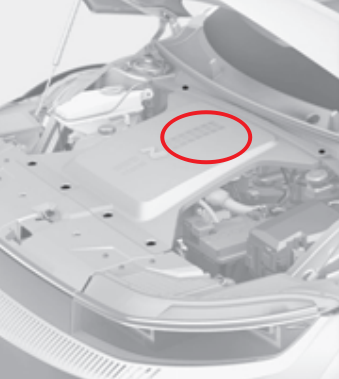
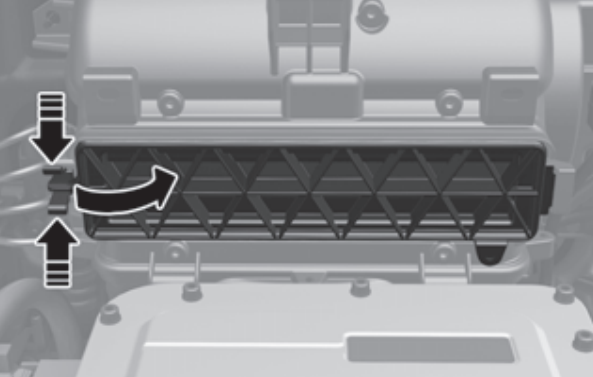

# 保养、维护、改装

## 雨刮

原厂：KCW三段式

替换无骨：

- 主驾26寸（压力≤650克）
- 副驾18寸（压力≤550克）
- U型接口

两根雨刮有1寸的余量，不要同时延长，可能会打架

**如何打开雨刮维护模式：** 熄火后20秒内把雨刮拨杆往下掰，也就是到MIST挡，保持两三秒，雨刮就会抬起

## 空调滤芯

原厂零件号：`97133-L1000`

和这些车型通用：

- 索纳塔十代
- 凯酷
- 起亚K5
- 全新伊兰特（大概22-26款都行）
- GV60

**型号参考：** 马勒LAK1840，曼牌CUK21032

**如何更换：**

打开机盖，在黑色罩子下方，直接如图所示把盖子打开换，有手就行。**注意空气流向是从上到下，即箭头要朝下指**

## 电瓶

瓦尔塔圆标AGM60

## 轮毂
5*114.3 ，中心孔67.1，M14-P1.5锥面螺帽

轮径不要变化超过2%否则影响ABS

参考数据：

- 原厂21寸 9.5J ET45
- 官改20寸 10.5J ET40（合适的轮胎较少，适合装275 285走街）
- 最佳21寸 10.5-11J，做倾角ET35或更小，不做可以ET40（适合有赛道需求的，轮胎好买，用305 315）

轮毂螺丝扭力：**180NM**

## 轮胎

- 倍耐力P0R（街胎王）
- 马牌SC7（略欠于P0R）
- 马牌MC7（日用最佳，耐磨、湿地性能好）
- 邓禄普Sport Max RS（略不耐磨的SC7，性价比很高）
- PT01（赛道首选）

## 偏心螺丝

hardrace 6702（m14）

两颗即可，只换上面的，不要全换，重量吃不消

无短簧可以到2.5度倾角，有短簧可以到3度

## 胎压传感器

买一套元征的用OBD复制就行

复制时型号选择：IONIQ5 → 2020-2025(433MHz[52940L1100])

装好后胎压警报消失就说明工作正常，跑半小时一小时就能刷出数据，以后和原厂的工作无差异

## OBD监测器

Vgate iCar pro2S

## 其他数据

原厂刹车皮零件号：前`58101-NIA00`，后`58302-NIA00`

刹车盘：前400mm，后360mm

胎压：2.4BAR

四轮定位：

|   项目   |     前      |     后     |
| :------: | :---------: | :--------: |
|  外倾角  | -1.5°±0.5°  | -1.5°±0.5° |
|  总前束  |  0.2°±0.2°  | 0.26°±0.2° |
| 主销后倾 | 5.78°±0.5°  |     /      |
| 主销内倾 | 13.64°±0.5° |     /      |

